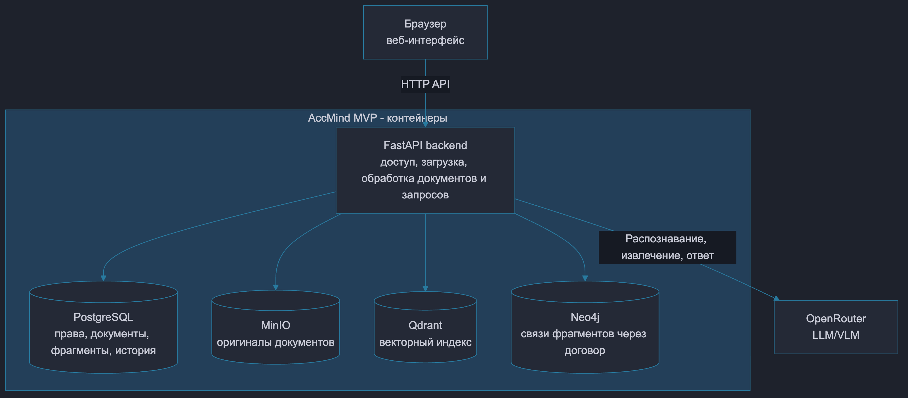
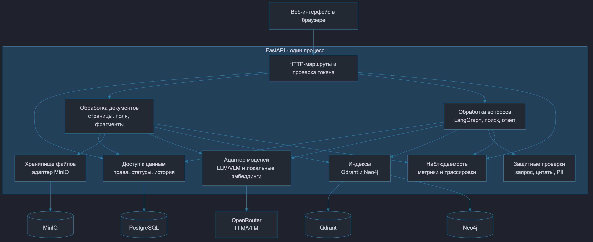

# ДЗ2. Проектирование системы анализа документов на основе LLM

Система использует LLM для анализа бухгалтерских документов и ответов на вопросы. Пользователь загружает договоры, акты и платежи, задаёт вопросы и получает ответы с цитатами и оригиналами.

## Архитектура

Frontend выполняется в браузере. Backend на FastAPI обрабатывает HTTP-запросы и документы, выполняет поиск и расчёты, а также обращается к LLM для генерации ответов. Запросы пользователя поступают через `POST /api/v1/queries`.

### C2: контейнеры



Диаграмма показывает Frontend в браузере, FastAPI Backend, PostgreSQL (SQL DB), Qdrant (Vector DB), Neo4j (Graph DB), MinIO (оригиналы документов) и внешние LLM/VLM.

Backend принимает файлы, обрабатывает документы и вопросы, проверяет доступ, выполняет поиск, расчёты и генерацию. Эмбеддинги вычисляются локально в этом процессе.

### C3: компоненты Backend



Диаграмма раскрывает API, включая загрузку документов и вопросы. Для сценария вопроса используются следующие компоненты:

| Компонент | Ответственность |
|---|---|
| HTTP-маршруты и проверка токена | Определение пользователя по Bearer-токену, валидация, лимиты и запуск обработки вопроса |
| Обработка вопросов | Проверка запроса, поиск, расширение контекста, точные расчёты сумм, генерация и проверка ответа |
| Доступ к данным | Проверка прав, точный поиск, чтение доступных готовых фрагментов, история и аудит |
| Индексы | Векторный поиск в Qdrant и поиск связей в Neo4j с фильтрами организации и прав доступа |
| Взаимодействие с моделями | Эмбеддинги, сборка промпта, вызов LLM и проверка структуры ответа и ссылок на цитаты |
| Защитные проверки | Проверка вопроса, цитат и маскирование некоторых форматов персональных данных |
| Наблюдаемость | Длительности, статусы, ошибки и трассировка этапов |

Ответ формируется с помощью RAG: система находит доступные фрагменты документов и передаёт их вместе с вопросом LLM. Компонент взаимодействия с моделями вычисляет эмбеддинги, собирает промпт и отправляет запросы LLM.

Компоненты загрузки и хранения файлов обслуживают обработку документов в том же Backend.

## Sequence: пользователь запрашивает рекомендацию


Рекомендация — ответ бухгалтеру по доступным документам, с подтверждающими источниками. Пример вопроса: «Какие документы об оплате найдены и что следует сверить?»

Диаграмма последовательности показывает взаимодействие пользователя, API, хранилищ и LLM. API объединяет HTTP-маршруты и внутренние компоненты C3.

| Шаг Sequence | Компоненты C3 |
|---|---|
| Проверка токена и прав | HTTP-маршруты, доступ к данным / PostgreSQL |
| Проверка вопроса | Обработка вопросов, защитные проверки |
| Поиск и расширение контекста | Обработка вопросов, доступ к данным, взаимодействие с моделями, индексы / Qdrant / Neo4j |
| Отбор доступных фрагментов | Доступ к данным / PostgreSQL, обработка вопросов |
| Расчёт сумм | Обработка вопросов |
| Передача вопроса и доступных фрагментов документов LLM | Взаимодействие с моделями / LLM |
| Проверка цитат и маскирование данных | Взаимодействие с моделями, защитные проверки |
| Повторная проверка доступа | Обработка вопросов, доступ к данным / PostgreSQL |
| Выдача ответа | HTTP-маршруты; сохранение истории и аудита, запись метрик |

Векторный поиск используется при отсутствии подходящих точных совпадений. В режиме `graph` контекст расширяется через Neo4j; в режиме `vector` расширение пропускается. Для явного номера договора в режиме `graph` векторный fallback ограничен. При недостатке источников или изменении доступа возвращается соответствующий статус без источников. Некоторые вопросы об актах обрабатываются без вызова LLM.

Суммы рассчитываются по доступным документам с подтверждающими цитатами.

## API

```http
POST /api/v1/queries HTTP/1.1
Host: localhost:8080
Authorization: Bearer <персональный токен>
Content-Type: application/json

{
  "question": "Какие документы об оплате найдены и что следует сверить?",
  "mode": "graph"
}
```

Параметры запроса:

| Параметр | Значение |
|---|---|
| `question` | Вопрос пользователя по документам. Обязательная строка длиной 1–2000 символов. |
| `mode` | Режим поиска: `vector` — поиск без расширения по связям; `graph` — поиск с добавлением связанных фрагментов через граф документов. По умолчанию `graph`. |

Дополнительные поля запрещены. Пользователь, организация (`tenant`) и группы доступа определяются сервером по токену.

Поля ответа:

| Поле | Значение |
|---|---|
| `status` | Результат обработки: `answered` — ответ сформирован; `blocked` — запрос заблокирован; `insufficient_evidence` — недостаточно подтверждающих источников; `unavailable` — доступ к источникам изменился, нужно повторить запрос. |
| `answer` | Текст ответа или пояснение причины отказа. |
| `citations` | Подтверждающие фрагменты документов: ID фрагмента и документа, имя файла, страница и текст. |
| `paths` | Связи между исходными и найденными фрагментами через общий договор. |
| `calculations` | Рассчитанные суммы, количество учтённых актов и платежей и пояснение к расчётам. Может быть пустым; отсутствует при `status=unavailable`. Суммы передаются строками для сохранения десятичной точности. |
| `stages` | Выполненные этапы обработки и длительность каждого в миллисекундах. |
| `trace_id` | Идентификатор запроса для поиска связанных записей в журналах и трассировке. |

Типы данных и примеры запросов и ответов описаны в [OpenAPI](api/openapi.yaml).

| HTTP | Значение |
|---|---|
| `200` | Результат со статусом `answered`, `blocked`, `insufficient_evidence` или `unavailable` |
| `401` | Нет действующего персонального токена |
| `422` | Ошибка валидации тела запроса |
| `429` | Лимит пользователя или заняты два слота обработки |
| `503` | Ошибка модели, хранилища или обработки; `detail.code=query_failed` |

