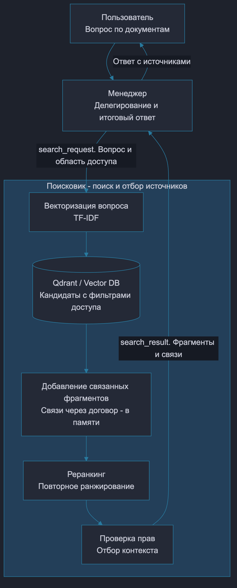
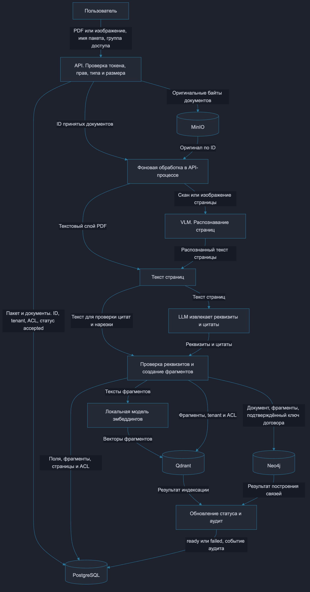
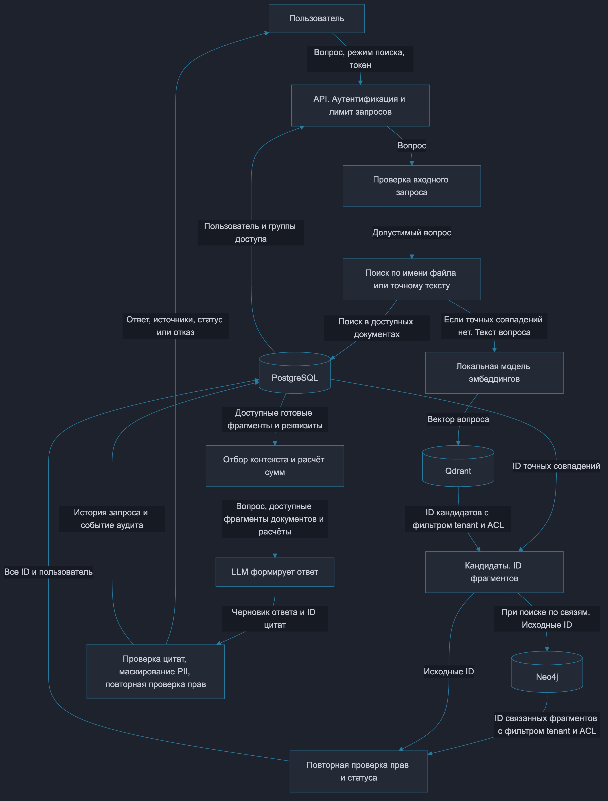

# ДЗ3. RAG и взаимодействие агентов

Система анализирует бухгалтерские документы и отвечает на вопросы с подтверждающими источниками. RAG связывает поиск документов с генерацией ответа. Сначала находятся доступные фрагменты, затем они передаются LLM вместе с вопросом.

## Роли агентов

Используется паттерн «Менеджер - специализированный агент». Менеджер делегирует поиск Поисковику и получает результат через сообщение.

| Агент | Ответственность |
|---|---|
| Менеджер | Принимает вопрос, формирует задание на поиск, получает источники и возвращает итоговый ответ пользователю. |
| Поисковик | Находит доступные фрагменты, добавляет связанные документы, ранжирует кандидатов и возвращает источники Менеджеру. |

Поисковик отвечает за поиск, Менеджер - за управление запросом и ответ. Разбиение на фрагменты, эмбеддинги, хранилища и проверка прав являются инструментами этих ролей.

### Взаимодействие агентов

<a href="diagrams/agents.png"></a>

1. Пользователь задаёт вопрос. «Найди платежи по договору № 42».
2. Менеджер отправляет Поисковику сообщение `search_request` с вопросом и областью доступа пользователя.
3. Поисковик выполняет поиск, расширяет контекст связанными документами и повторно ранжирует кандидатов.
4. Поисковик возвращает `search_result` с фрагментами и найденными связями.
5. Менеджер проверяет актуальный доступ и возвращает ответ с источниками.

| Поле сообщения | Значение |
|---|---|
| `sender` | Отправитель. Менеджер или Поисковик. |
| `recipient` | Получатель. Другой агент или пользователь. |
| `type` | Задание на поиск, результат поиска или итоговый ответ. |
| `payload` | Данные сообщения. Вопрос и права пользователя, найденные фрагменты либо ответ. |

LangGraph хранит состояние запроса и задаёт переходы между ролями. Маршрутизация фиксирована. Менеджер → Поисковик → Менеджер → завершение.

## RAG-пайплайн

### Подготовка документов



| Этап | Обработка |
|---|---|
| Приём | Проверяются права на загрузку, тип и размер файла. Оригинал сохраняется в объектном хранилище. |
| Извлечение текста | Читается текстовый слой PDF. Изображения страниц распознаются с помощью VLM. |
| Реквизиты | LLM извлекает тип документа, номер и дату договора, ИНН, суммы и подтверждающие цитаты. |
| Чанкинг | Текст каждой страницы делится на фрагменты длиной до 1800 символов с шагом 1600. Перекрытие соседних полных фрагментов - 200 символов. |
| Метаданные | Фрагмент получает ID, документ, страницу, организацию, группы доступа и подтверждённый ключ договора. |
| Эмбеддинги | Локальная модель `paraphrase-multilingual-MiniLM-L12-v2` преобразует тексты в векторы размерности 384. |
| Индексы | Qdrant хранит векторы и метаданные. Neo4j - связи документов и фрагментов через договор. PostgreSQL хранит реквизиты, тексты, права и статусы. |
| Готовность | Документ становится доступным для поиска после успешной обработки и индексации. |

Чанкинг сохраняет границы страниц, чтобы цитату можно было найти в оригинале. Перекрытие уменьшает риск потери информации на границе фрагментов. Размеры заданы в символах.

### Поиск и формирование ответа



1. Проверяются пользователь и допустимость вопроса.
2. Выполняется поиск по имени файла или точным совпадениям. При отсутствии подходящих совпадений вопрос преобразуется в вектор и выполняется поиск в Qdrant.
3. В режиме `graph` Neo4j добавляет фрагменты, связанные с найденными через общий договор. В режиме `vector` этот шаг пропускается.
4. В PostgreSQL повторно проверяются права и готовность источников. Контекст ограничивается по объёму. Вопросы с неоднозначным договором требуют уточнения.
5. Подтверждённые суммы рассчитываются кодом с десятичной точностью. LLM получает вопрос, разрешённые фрагменты и расчёты.
6. Проверяются цитаты и актуальные права. Пользователю возвращается ответ с источниками.

Qdrant отвечает за сходство текста, Neo4j - за явные связи документов. Совместное использование помогает найти и релевантный фрагмент, и относящиеся к нему акты или платежи. Ключ договора включает номер, дату и ИНН. Связь создаётся только при наличии подтверждающей цитаты.

### Реранкинг

Реранкинг - повторное ранжирование уже найденных кандидатов перед выбором контекста. В прототипе сначала выполняется поиск в Qdrant и добавление связанных фрагментов, затем кандидаты сортируются по совпадениям значимых слов вопроса и векторной оценке. Повторные ID удаляются. Выбираются до четырёх фрагментов.

Номер договора проверяется отдельно через фильтр. Проверки организации, прав доступа и готовности применяются независимо от оценки релевантности.

В полном контуре отдельной модели реранкинга сейчас нет. После поиска применяются проверки доступа и отбор контекста.

## Notebook

[Открыть notebook](rag_agents.ipynb) · [Открыть в Colab](https://colab.research.google.com/github/slackman/ai-architect/blob/main/%D0%94%D0%973/rag_agents.ipynb)

В примере используются синтетические документы, Qdrant в памяти процесса, векторизация TF-IDF и лексический реранкинг. Связи документов хранятся в памяти. Менеджер собирает ответ из цитат без вызова LLM.

TF-IDF представляет текст вектором по словам. Такой вариант позволяет проверить обмен сообщениями и фильтры доступа без скачивания моделей.

При запуске выводится журнал.

```text
manager → searcher: search_request
searcher → manager: search_result
manager → user: answer
```

Проверки в notebook охватывают правильный договор, права читателя и бухгалтера, исключение документов другой организации и неготовых документов, отсутствие источников, изменение прав, перекрытие фрагментов и повторное ранжирование.

