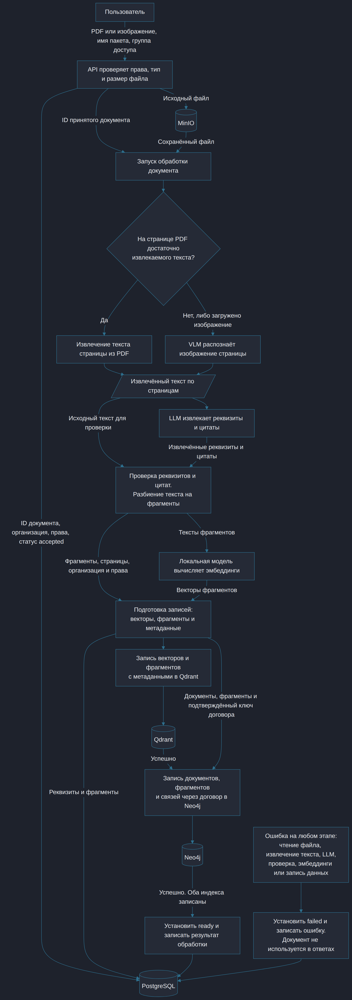
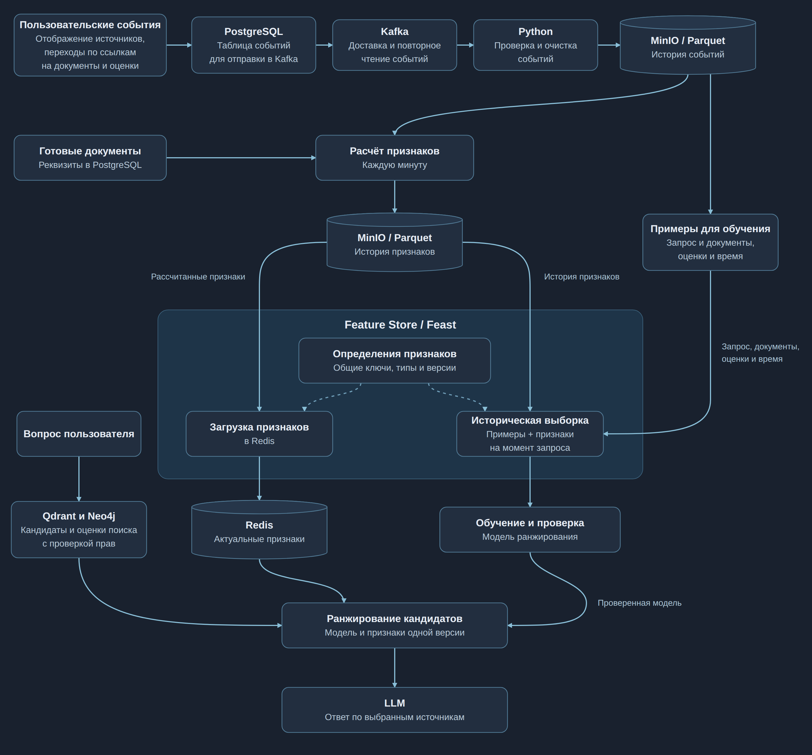

# ДЗ5. Потоки данных и хранилища

Система отвечает на вопросы по договорам, актам и платёжным поручениям. Сначала она обрабатывает загруженные файлы и подготавливает их для поиска. Затем по вопросу пользователя находит подходящие фрагменты и передаёт их LLM для подготовки ответа с источниками.

Для выбора полезных источников используется модель ранжирования. Она меняет порядок найденных документов с учётом их характеристик и прошлых оценок пользователей. События действий пользователей поступают в обработку, а рассчитанные признаки сохраняются в Feature Store для обучения и работы модели.

## Источники данных

| Источник | Как поступают данные |
|---|---|
| PDF и изображения договоров, актов и платежей | Пользователь загружает файлы, которые обрабатываются пакетами. |
| Реквизиты и связи документов | Читаются из PostgreSQL и Neo4j после завершения обработки документов. |
| Отображение ссылок на источники, переходы по ссылкам на документы и оценки полезности | События поступают по мере действий пользователей. На их основе раз в минуту пересчитываются показатели документов. |

## Схема ETL/ELT: от файла до поиска

1. API проверяет права пользователя, тип и размер файла. Оригинал сохраняется в MinIO, сведения о документе и его статус – в PostgreSQL.
2. Для каждой страницы PDF проверяется, достаточно ли в ней извлекаемого текста. Если достаточно, текст читается напрямую. Иначе изображение страницы распознаёт VLM – модель, работающая с изображениями. Загруженные изображения также проходят распознавание.
3. LLM извлекает реквизиты: например, номер договора и сумму. Приложение проверяет, что реквизиты подтверждаются цитатами из документа.
4. Текст делится на фрагменты до 1800 символов. Соседние фрагменты перекрываются на 200 символов, чтобы не потерять смысл на границе.
5. Локальная модель преобразует каждый фрагмент в эмбеддинг – набор из 384 чисел, по которому можно искать близкие по смыслу тексты. Векторы, фрагменты, номера страниц и права доступа объединяются в записи Qdrant. После успешной записи в Qdrant документы, фрагменты и связи через договор записываются в Neo4j. Реквизиты и тексты фрагментов сохраняются в PostgreSQL.
6. Только после успешной записи обоих индексов документ получает статус `ready` и участвует в поиске. Ошибка на любом этапе обработки приводит к статусу `failed`. Такой документ не используется в ответах, даже если часть записей уже появилась в индексах. При повторной обработке прежние записи индексов удаляются и создаются заново.

В этой схеме сочетаются два подхода. **ELT**: сначала сохраняем исходный файл, затем преобразуем его. **ETL**: сначала подготавливаем текст, реквизиты и векторы, затем загружаем результат в поисковые хранилища. Очистка и проверка данных находятся перед записью в индексы, а генерация эмбеддингов – после разбиения текста.

## От действий пользователя до обучения модели

Система фиксирует отображение ссылок на источники, переходы по ним и отметки «Полезно» или «Не полезно». API проверяет эти события и сохраняет их в PostgreSQL. В той же транзакции события добавляются в таблицу для отправки в Kafka. Отдельный обработчик передаёт их в Kafka. Если отправка не удалась, события остаются в таблице для повторной попытки.

Обработчик проверяет формат события, организацию, запрос и документ. У события есть уникальный ID, время действия и время получения. Повторные события не учитываются второй раз. История сохраняется в MinIO в файлах Parquet – табличном формате для последующих расчётов.

Раз в минуту обработчик рассчитывает **признаки** – характеристики, которые получает модель ранжирования. Например: тип документа, количество фрагментов, наличие суммы и число переходов по ссылке на документ за последние семь дней. Значения относятся к конкретной организации, документу и версии документа.

Оценки пользователей помогают определить, какие источники были полезны. Для обучения сохраняются вопрос, показанные документы, их поисковые оценки и версия индекса. Запись обучающего примера включает организацию, ID запроса, документ и его версию, время запроса и явную оценку пользователя. По этим ключам и времени к примеру присоединяются исторические признаки. Отсутствие перехода по ссылке само по себе не считается отрицательной оценкой. Оценка, поставленная после показа, служит результатом для обучения, но не входит в признаки этого же показа.

При ответе на новый вопрос Qdrant и Neo4j находят документы с учётом прав пользователя. Для найденных документов приложение получает признаки из Redis через Feast. Модель использует их вместе с оценками поиска по текущему вопросу, меняет порядок источников и передаёт выбранные фрагменты в LLM. Такие же поисковые оценки сохраняются в обучающих примерах.

## Выбор хранилищ

| Технология | Назначение и причина выбора |
|---|---|
| MinIO | Хранит оригиналы, историю событий и историю рассчитанных признаков. |
| PostgreSQL | Хранит тексты, реквизиты, права, статусы и задания на отправку событий. |
| Kafka | Принимает поток событий и хранит его для обработки. После сбоя обработчик возобновляет обработку с последнего подтверждённого события. |
| Feast | Хранит определения признаков и организует получение их исторических и актуальных значений. Сами значения рассчитывает обработчик. |
| Redis | Хранит последние опубликованные значения признаков для быстрого получения во время ответа пользователю. |
| Qdrant | Хранит эмбеддинги и находит фрагменты с близким смыслом. |
| Neo4j | Хранит связи между договорами, актами и платежами, чтобы дополнять результаты поиска связанными документами. |

## Согласованность обучения и инференса

**Единый расчёт.** Обе ветки используют одни определения, код преобразований, типы, значения по умолчанию и временные окна. Рассчитанный снимок сначала записывается в offline-историю, затем материализуется в Redis. Это снижает риск training-serving skew – расхождения признаков при обучении и использовании модели.

**Время доступности.** Историческая выборка использует только значения, опубликованные к моменту запроса. В Feast временной меткой снимка служит время публикации признаков. Время исходного события хранится отдельно для расчёта окон. Запоздавшие события влияют на следующий снимок и не переписывают прошлый. Реквизиты документов сохраняются по версиям, чтобы обучение не использовало более поздние изменения. Выборка на момент времени предотвращает попадание будущих данных в обучение. 

**Версии и публикация.** Версии признаков, данных и модели фиксируются вместе. Новая версия признаков публикуется под отдельным именем. Модель переключается только после проверки наполнения online-хранилища и сравнения значений с offline-снимком. Разница времени публикации снимка и фактической доступности Redis фиксируется в журнале публикаций.  

**Свежесть и отказоустойчивость.** Целевой интервал обновления поведенческих признаков – одна минута, допустимое отставание – пять минут. При просрочке признаков, отсутствии версии или недоступности Redis используется поиск без обучаемого ранжирования. Доставка событий допускает повторы. Запись истории и повторный расчёт идемпотентны. Обработчик подтверждает обработку событий в Kafka только после сохранения данных. Ошибки схемы событий направляются в отдельную очередь для разбора.

**Права и качество.** Перед ранжированием и выдачей проверяются организация, доступ и готовность документов. Feature Store не определяет права пользователя. Контролируются пропуски, дубли, задержки, типы и расхождения offline/online. Для эмбеддингов фиксируются версия модели, размерность и правила разбиения. При смене модели создаётся новая коллекция Qdrant и заново рассчитываются векторы всех документов. Разные модели создают разные векторные пространства, в том числе при одинаковой размерности.
