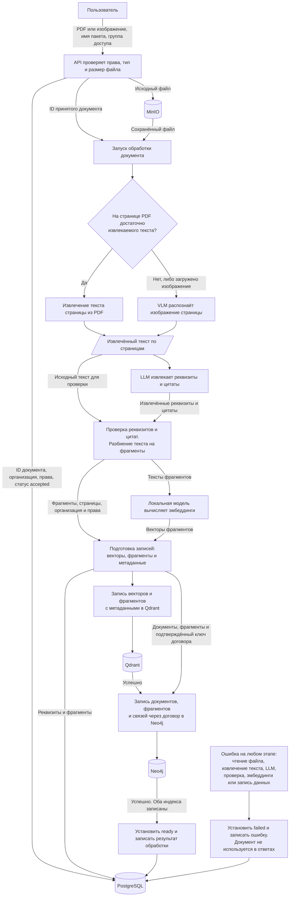

## Загрузка и индексация документов

Прямоугольники обозначают действия, параллелограмм – данные, цилиндры – хранилища, ромб – выбор способа извлечения текста. Подписи «успешно» задают порядок записи индексов. Ошибка любого этапа обработки переводит документ в `failed`.

Записи в PostgreSQL, Qdrant и Neo4j не объединены общей транзакцией. Если запись одного индекса прошла, а следующая завершилась ошибкой, частичные записи могут сохраниться. Документ остаётся недоступным для ответов благодаря проверке статуса. При повторной обработке прежние записи индексов удаляются и создаются заново.
