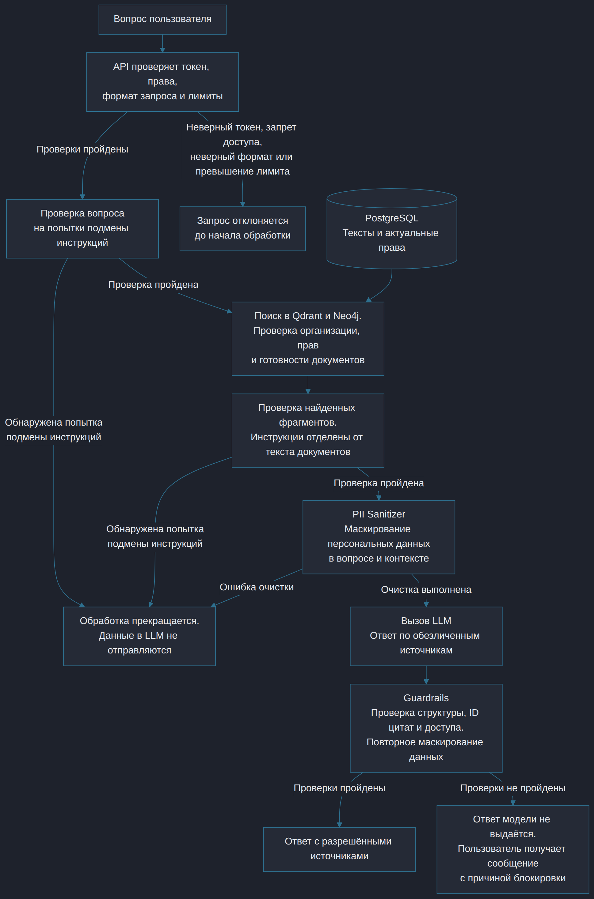

# ДЗ6. Качество, безопасность и наблюдаемость

Система анализирует бухгалтерские документы и отвечает на вопросы с цитатами и ссылками на источники. Защита включает проверку прав доступа, маскирование персональных данных перед отправкой в LLM и проверку ответов модели. Качество RAG оценивается на размеченном наборе вопросов. Метрики и трассировка используются для контроля задержек, ошибок, нагрузки и стоимости обработки.

## Защита данных и ответов

- API проверяет токен, права пользователя, формат и размер запроса. Ограничиваются частота запросов и число одновременных обработок. Неверный токен, запрет доступа, неверный формат и превышение лимита приводят к отклонению запроса до вызова LLM.
- Поиск учитывает организацию, группы доступа и готовность документов. Найденные источники повторно проверяются перед передачей контекста модели и перед выдачей ответа.
- При загрузке оригинал сохраняется в MinIO с ограничением доступа. Текстовый слой PDF читается локально, сканы распознаются VLM. **PII Sanitizer** маскирует персональные данные перед передачей текста внешней LLM для извлечения реквизитов. При ответе на вопрос такая же проверка применяется к вопросу и найденному контексту. Если очистка завершилась ошибкой, внешний вызов отменяется.
- Вопрос и найденные фрагменты проверяются на попытки подмены инструкций. При обнаружении такой попытки обработка прекращается. Системные инструкции отделены от содержимого документов, текст источников используется как данные. Проверки прямых атак в вопросе и скрытых инструкций в документах входят в план тестирования.
- **Guardrails** проверяет структуру ответа, допустимость ID цитат и наличие цитируемых фрагментов в разрешённом контексте. Персональные данные повторно маскируются. Если проверки не пройдены, ответ модели не выдаётся. Пользователь получает сообщение с причиной блокировки.

В журналах и трассировке сохраняются ID запроса, этапы, длительности и коды результата. После извлечения реквизитов проверяются цитаты и структура данных. Документы с ошибками обработки не используются в ответах. Тексты документов, персональные данные, промпты и токены доступа не записываются.

## План тестирования RAG

Для оценки используется Ragas. Набор из 50 размеченных вопросов включает договоры, акты, платежи, сканы, неоднозначные запросы и случаи отсутствия ответа. Для каждого примера фиксируются вопрос, эталонный ответ, ожидаемые источники и права пользователя.

| Проверка | Критерий |
|---|---|
| Обоснованность ответа | Утверждения ответа подтверждаются найденным контекстом. Целевое среднее значение не ниже 0.90. |
| Соответствие вопросу | Ответ соответствует вопросу. Целевое среднее значение не ниже 0.80. |
| Поиск и цитаты | Нужные документы присутствуют в результатах, ссылки указывают на существующие разрешённые фрагменты. |
| Расчёты | Суммы совпадают с эталоном. При расчёте каждый документ учитывается один раз. |
| Недостаток данных | При отсутствии источников или неоднозначности система сообщает об этом и не придумывает ответ. |
| Безопасность | Проверяются подмена инструкций в вопросе и документе, маскирование данных при загрузке и ответе, чужая организация, закрытые источники и потеря доступа к документу во время подготовки ответа. При ошибке очистки внешний вызов отменяется. При неверном токене, запрете доступа или превышении лимита запрос отклоняется до вызова модели. |

Обоснованность ответа (Faithfulness) и соответствие вопросу (Answer Relevancy) оцениваются для вопросов с ожидаемым содержательным ответом. При недостатке данных или блокировке запроса сообщение пользователю сверяется с ожидаемым результатом теста. Автоматическую оценку дополняет ручной разбор ошибок и проверка финансовых фактов. Утечки данных и выдача закрытых источников недопустимы независимо от средних оценок.

Прогон выполняется перед выпуском и после изменения модели, промпта, правил разбиения текста или поиска. Фиксируются версии набора, модели, индекса и модели для оценки качества ответов, найденный контекст, ответ и результаты по каждому примеру. Модель для оценки качества ответов получает только обезличенные данные.

## Виджеты Grafana

Prometheus собирает метрики для Grafana, OpenTelemetry связывает этапы одного запроса, Jaeger используется для разбора трасс. Для каждого вызова LLM фиксируются операция, длительность, модель, входные и выходные токены, стоимость, ошибки и повторы. Запросы, поиск, индексация и защитные проверки также передают длительность и результаты обработки.

| Виджет | Что показывает |
|---|---|
| Latency | p50, p95 и p99 полного запроса, а также длительности поиска и генерации. |
| Traffic | Число запросов в секунду и распределение по операциям. |
| Errors | Доля технических ошибок, HTTP 5xx, ошибки и таймауты модели. Указывается число запросов, заблокированных защитными проверками, с группировкой по причинам. |
| Saturation | Число активных обработок относительно лимита, доля HTTP 429 и загрузка CPU/RAM. |
| Token use | Входные и выходные токены по модели. Расход токенов представлен по двум операциям: загрузка документов и ответы пользователю. |
| Average Cost per Request | Стоимость всех вызовов LLM, связанных с ответами, включая повторы, делённая на число принятых вопросов за тот же период. Также приводится средняя стоимость обработки одного загруженного документа. |

Расход токенов определяется по данным провайдера модели. Стоимость рассчитывается по тарифу с учётом повторных вызовов. На дашборде можно выбрать период, операцию и модель.
