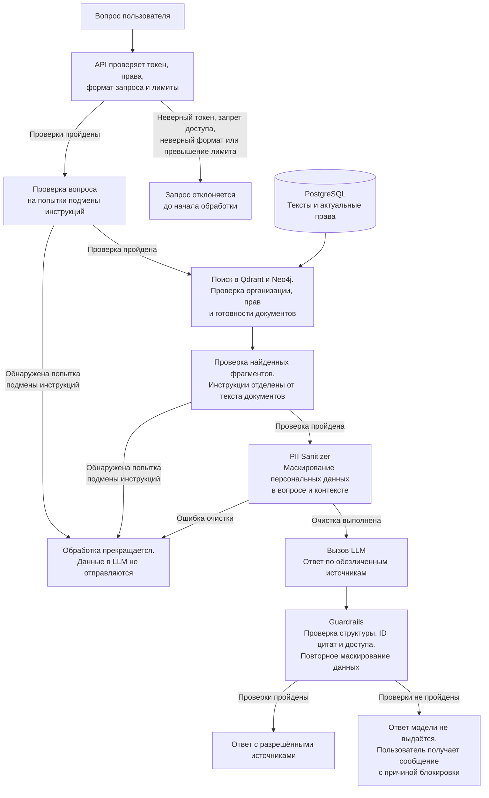

## Защита вопроса и ответа

Неверный токен, запрет доступа, неверный формат запроса и превышение лимита обрабатываются до вызова модели. Проверка прав повторяется перед отправкой контекста и перед выдачей ответа. Технические ошибки модели и блокировки защитных проверок имеют разные коды результата.
