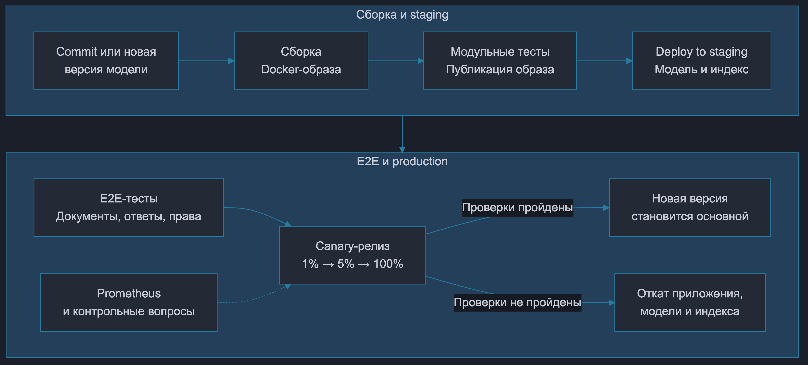
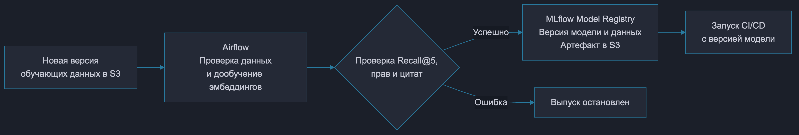

# ДЗ8. Автоматизация поставки LLM-сервиса

Система обрабатывает бухгалтерские документы и отвечает на вопросы с источниками.

## Инфраструктура

Для автоматического создания инфраструктуры используется Terraform. Он создаёт виртуальную сеть с отдельными подсетями для внутренних сервисов, Kubernetes-кластеры для проверки и рабочего запуска, группы CPU- и GPU-узлов, реестр Docker-образов и PostgreSQL. GitHub Actions проверяет и применяет конфигурацию Terraform.

В S3 создаются отдельные хранилища оригиналов документов, обучающих данных и моделей с версионированием и разграничением доступа. Пароли и ключи поступают из хранилища секретов.

Через Helm устанавливаются Qdrant, Neo4j, Airflow, MLflow, Prometheus, Istio и Argo Rollouts. Данные и учётные записи staging и production разделены.

## CI/CD и обучение модели

Изменение кода запускает GitHub Actions. Собирается Docker-образ, выполняются модульные тесты доступа, расчётов и цитат. Образ сохраняется в реестре и разворачивается в staging. E2E-тесты проверяют загрузку документа, получение ответа и открытие источника под разными ролями. Ошибка любого этапа останавливает выпуск.

Новая версия обучающих данных в S3 запускает Airflow и дообучение модели эмбеддингов на обезличенных парах «вопрос - подходящий фрагмент». Договоры в обучающем и проверочном наборах не пересекаются. Для допуска Recall@5, доля всех нужных фрагментов, найденных в первых пяти результатах, должна быть не ниже 0.80 и не хуже текущей модели.

Прошедшая проверку модель регистрируется в MLflow с версией данных и результатами оценки, её файлы сохраняются в S3. Airflow запускает GitHub Actions с конкретной версией модели. При изменении только кода сохраняется текущая версия модели.

Для новой модели пересчитываются эмбеддинги документов и создаются отдельные коллекции Qdrant в staging и production. Перед Canary проверяются полнота индекса, размерность векторов и готовность сервиса.

Описание релиза фиксирует точную версию Docker-образа, модели MLflow и имя коллекции Qdrant. Каждая версия приложения использует свою модель и коллекцию. Обе коллекции обновляются при загрузке, изменении и удалении документов до завершения периода отката. Права повторно проверяются по PostgreSQL перед выдачей источников.

## Canary-релиз и откат

Argo Rollouts через Istio направляет новой версии **1% → 5% → 100%** запросов. Остальные запросы обслуживает предыдущая версия. Доля увеличивается автоматически после успешной проверки метрик.

Доля трафика увеличивается после накопления достаточного количества запросов и успешной проверки метрик. Если данных недостаточно или метрики недоступны, переход приостанавливается.

| Проверка | Условие отката |
|---|---|
| Ошибки HTTP 5xx и тайм-ауты | Доля выше 1% либо выше предыдущей версии на 0.5 процентного пункта за 5 минут |
| Время ответа p95 | Рост более чем на 20% относительно предыдущей версии за 5 минут при сопоставимой нагрузке |
| Ответы на контрольном наборе | Доля утверждений, подтверждённых источниками, ниже 90% или уменьшилась более чем на 3 процентных пункта относительно предыдущей версии |
| Права доступа и цитаты | Хотя бы один недоступный источник или ссылка на несуществующий фрагмент |

Prometheus собирает метрики отдельно по версиям. Контрольные вопросы автоматически отправляются обеим версиям. Argo Rollouts использует метрики и результаты ответов для проверки релиза. После перехода на 100% сравнение выполняется с сохранёнными результатами предыдущей версии. Нарушение прав вызывает немедленный откат.

При откате весь трафик возвращается предыдущей версии приложения с её моделью и коллекцией Qdrant. Предыдущая версия приложения, модель и коллекция Qdrant сохраняются в течение 24 часов после выпуска новой версии, чтобы при необходимости выполнить откат.
