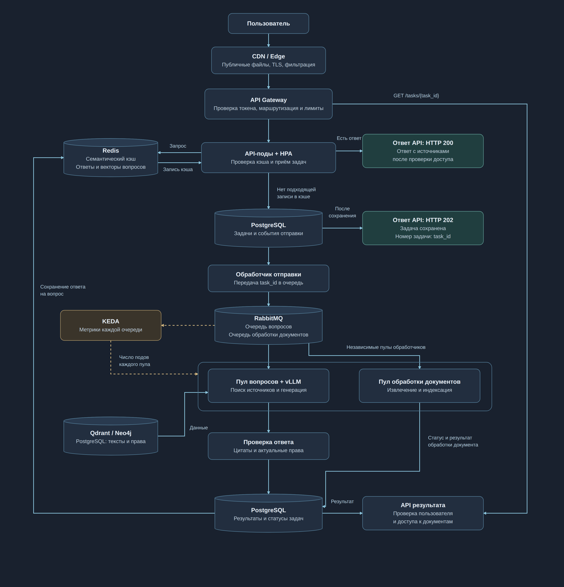

# ДЗ9. Архитектура для высокой нагрузки

Система отвечает на вопросы по бухгалтерским документам с цитатами и ссылками на источники. Для нагрузки 10 000 запросов в секунду используются кэширование, горизонтальное масштабирование и асинхронная обработка. Готовый ответ возвращается из кэша, а запрос, требующий генерации, получает номер задачи.

## Архитектура

Цель – p95 менее 200 мс для ответа из кэша или подтверждения приёма задачи. Измеряется время от отправки HTTP-запроса до получения ответа API. Новая генерация выполняется асинхронно. Выбран Kubernetes: API, сервис эмбеддингов и обработчики моделей масштабируются независимо. Модели обслуживаются в GPU-подах через vLLM и остаются загруженными в память.

## Кэширование

| Уровень | Что сохраняется и как используется |
|---|---|
| CDN / Edge | JavaScript, CSS и другие публичные файлы интерфейса. Запросы по документам передаются в API. |
| API Gateway | Публичные настройки и справочные данные. Для защищённых маршрутов общий кэш отключён. Шлюз проверяет токен, ограничивает частоту запросов и направляет обращения к API-подам. |
| Redis: ответы на одинаковые вопросы | Ответ для того же вопроса, параметров, пользователя и версии данных. Проверяется первым, без вычисления эмбеддинга. |
| Redis: семантический кэш | Векторы вопросов, ответы, источники и метаданные. Позволяет использовать сохранённый ответ при другой формулировке вопроса с тем же смыслом. |

Redis распределяет записи между шардами и использует реплики для восстановления после сбоя. Срок хранения записей выбирается с учётом изменений документов и доступной памяти.

### Алгоритм семантического кэша

1. API определяет организацию, пользователя и область доступа. Ключи и фильтры кэша учитывают параметры вопроса, версии документов, прав, модели и промпта.
2. Сначала проверяется точное совпадение вопроса и параметров. При его отсутствии сервис получает эмбеддинг вопроса из кэша эмбеддингов или вычисляет его локальной моделью.
3. Redis ищет похожие вопросы в пределах области доступа. Помимо сходства векторов должны совпасть тип вопроса и значимые параметры: договор, даты, суммы и валюта. Порог сходства подбирается на размеченных примерах.
4. Семантический кэш используется для проверенного набора типов вопросов, например об условиях расторжения одного и того же договора. Вопросы о суммах, платежах и изменяющихся статусах используют точный кэш.
5. Перед выдачей API проверяет актуальность источников и права доступа к ним. При изменении документов или прав обновляется версия, и прежние записи перестают использоваться.
6. Если подходящего ответа нет, создаётся задача на генерацию. После проверки и сохранения результата ответ с источниками добавляется в кэш. Ошибки и ответы без подтверждающих источников в кэш не записываются.

Таким образом, повторные вопросы обслуживаются без нового вызова LLM. Снижение нагрузки оценивается по доле запросов, получивших ответ из кэша.

## Горизонтальное масштабирование

API-поды не хранят состояние запросов в памяти. HPA изменяет их число по загрузке CPU и числу активных запросов. Сервис эмбеддингов масштабируется по своей нагрузке.

KEDA изменяет число inference-подов по размеру очереди RabbitMQ и скорости поступления задач. Пулы вопросов и обработки документов используют разные очереди и масштабируются независимо, чтобы длинные операции не задерживали ответы на вопросы.

Целевое число задач на под, минимальный и максимальный размеры пулов определяются нагрузочным тестом с учётом времени ожидания и доступных GPU. Минимальный пул сохраняет загруженные модели. Для роста пула предусматривается автомасштабирование GPU-узлов. Новый под принимает задачи после загрузки модели и проверки готовности, а при уменьшении пула обработчики завершают текущую работу.

## Асинхронная обработка

1. Если в кэше нет ответа, API сохраняет задачу и событие для отправки в очередь одной транзакцией. После сохранения возвращается **HTTP 202** с `task_id`.
2. Обработчик отправки передаёт `task_id` в RabbitMQ и ожидает подтверждения сохранения сообщения. При сбое отправка повторяется.
3. Обработчик вопроса проверяет права, находит источники в Qdrant и Neo4j и формирует ответ через vLLM. Затем проверяются цитаты и актуальный доступ к документам.
4. Результат и статус сохраняются в PostgreSQL. После этого подтверждается обработка сообщения в RabbitMQ. Повторные запросы и доставка сообщений учитываются по идентификаторам, чтобы избежать создания дубликатов задач и результатов.
5. Пользователь запрашивает статус и ответ через API Gateway по `GET /tasks/{task_id}`. API проверяет пользователя и доступ к документам. Пока задача выполняется, возвращается её статус и рекомендуемый интервал следующей проверки.

Число повторных попыток ограничено. Задачи, которые не удалось выполнить, направляются в очередь разбора ошибок. При перегрузке API ограничивает приём новых задач и сообщает, когда можно повторить запрос. Это предотвращает неограниченный рост очереди.

## Проверка задержки и нагрузки

Нагрузочный тест проверяет работу при 10 000 запросов в секунду: выдачу из точного и семантического кэша, приём новых задач и получение результатов. Дополнительные обращения за статусом учитываются в общей нагрузке. Также проверяются пустой кэш, рост доли уникальных вопросов и сбои компонентов.

Prometheus и Grafana показывают p95 API, долю попаданий в кэш, число новых генераций, время ожидания в очереди, время получения готового ответа, число обработчиков и ошибки. Цель для API – p95 менее 200 мс. При недостатке мощности проверяются ограничение приёма и восстановление обработки после снижения нагрузки.

## Географическое размещение

При работе в нескольких регионах Geo-DNS направляет пользователя к ближайшему Edge, который обслуживает публичные файлы, завершает TLS и фильтрует трафик. Запросы по документам направляются в регион хранения данных организации. API, кэш, очереди и модели располагаются в этом регионе, чтобы сократить сетевые задержки.
