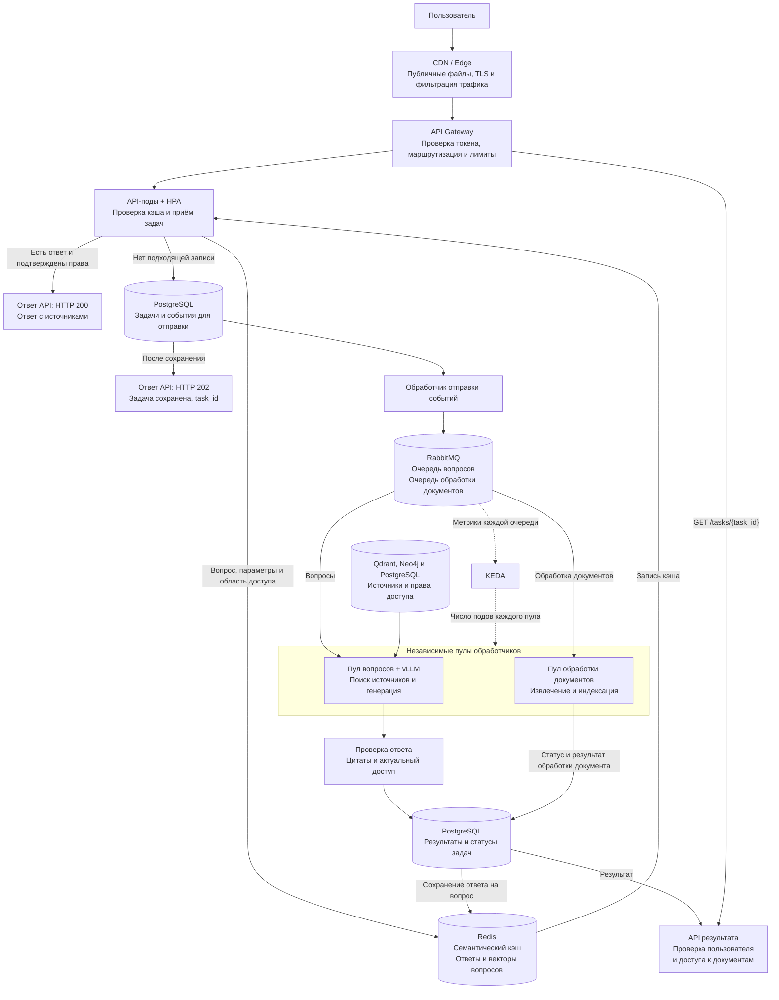

## Архитектура

Сплошные стрелки показывают движение запросов и данных, пунктирные – управление масштабированием. Обозначения PostgreSQL относятся к одному логическому хранилищу задач, результатов, текстов и прав доступа. HTTP 200 и HTTP 202 формирует API. Стрелка от PostgreSQL к HTTP 202 обозначает условие возврата ответа: задача уже сохранена.

Клиент обращается к API результата через API Gateway по `task_id`. Пулы вопросов и обработки документов используют свои очереди и масштабируются независимо. На схеме показаны приём задач и получение результатов. Чтение оригиналов документов и запись индексов внутри обработки документов опущены. В кэш добавляются только проверенные ответы на вопросы. Подтверждение обработки сообщения отправляется после сохранения результата. Обработка сбоев описана в README.
