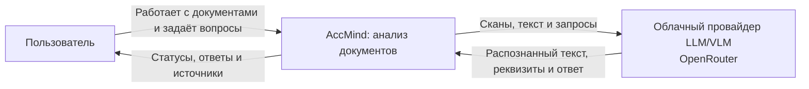
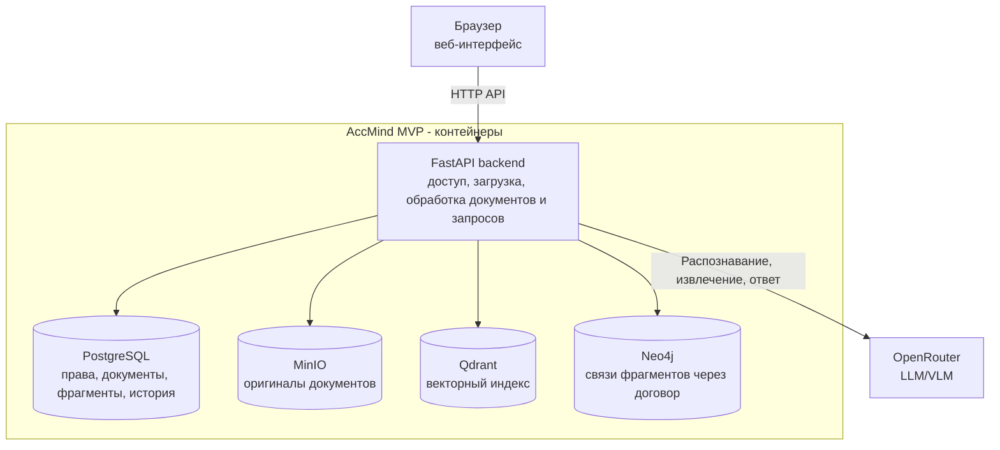
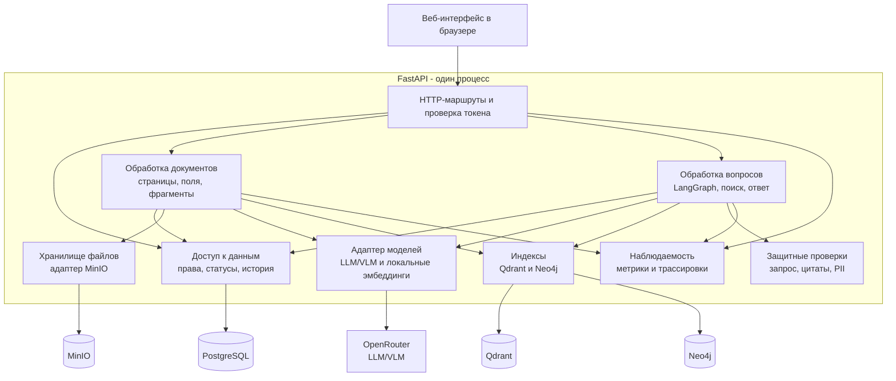
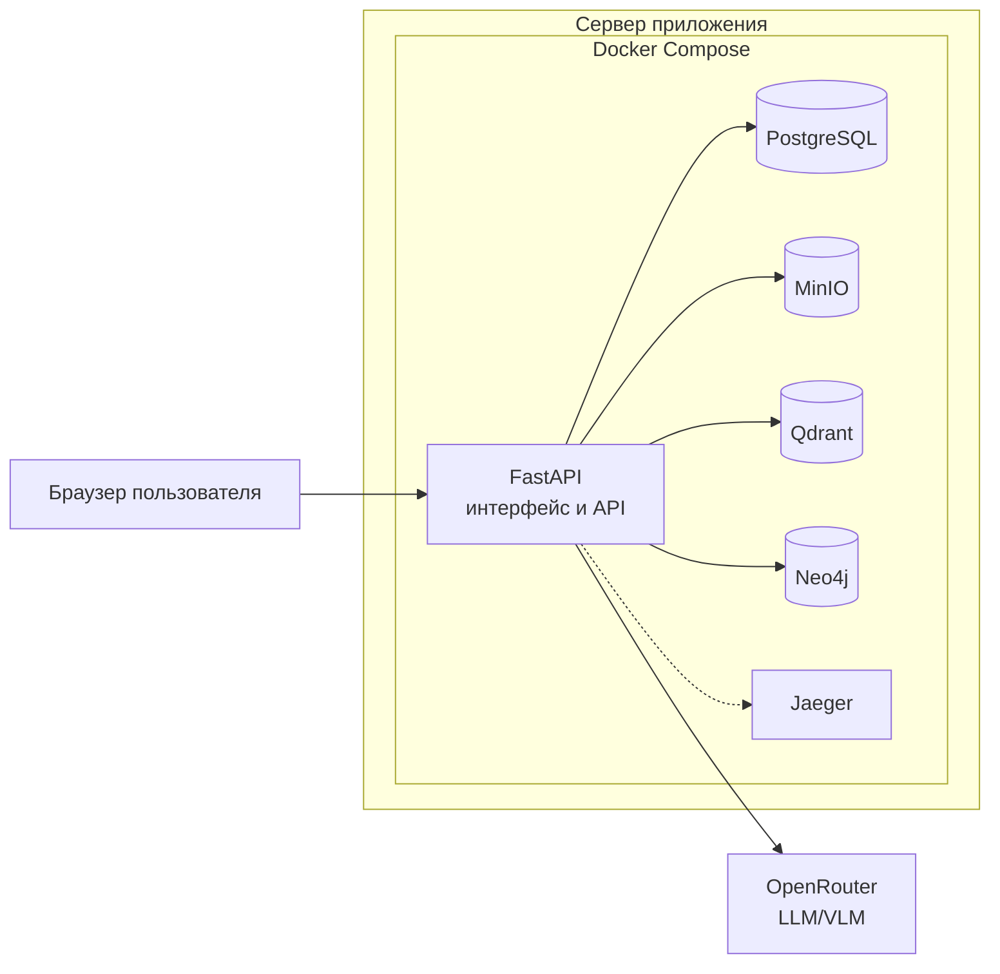
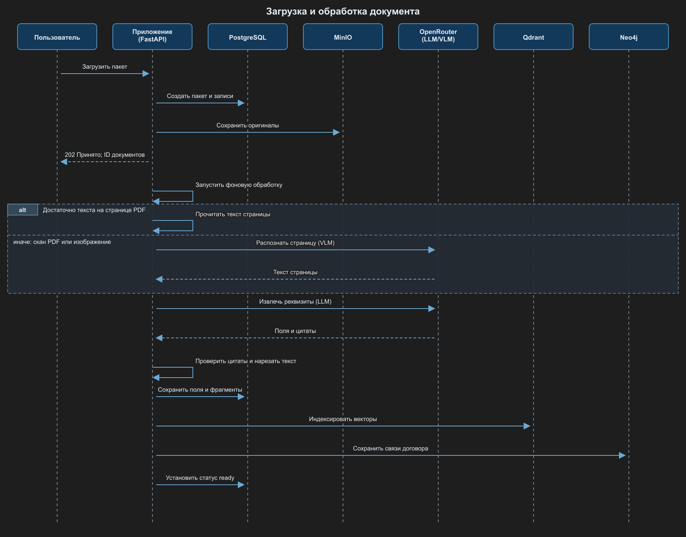
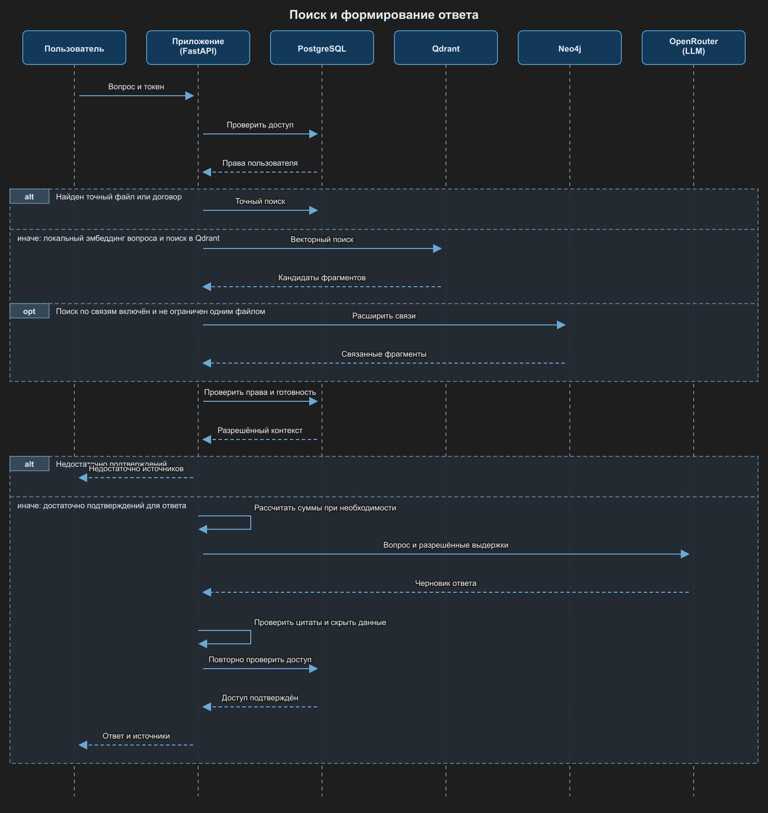
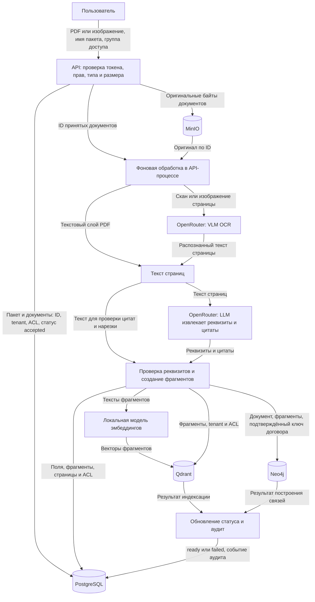
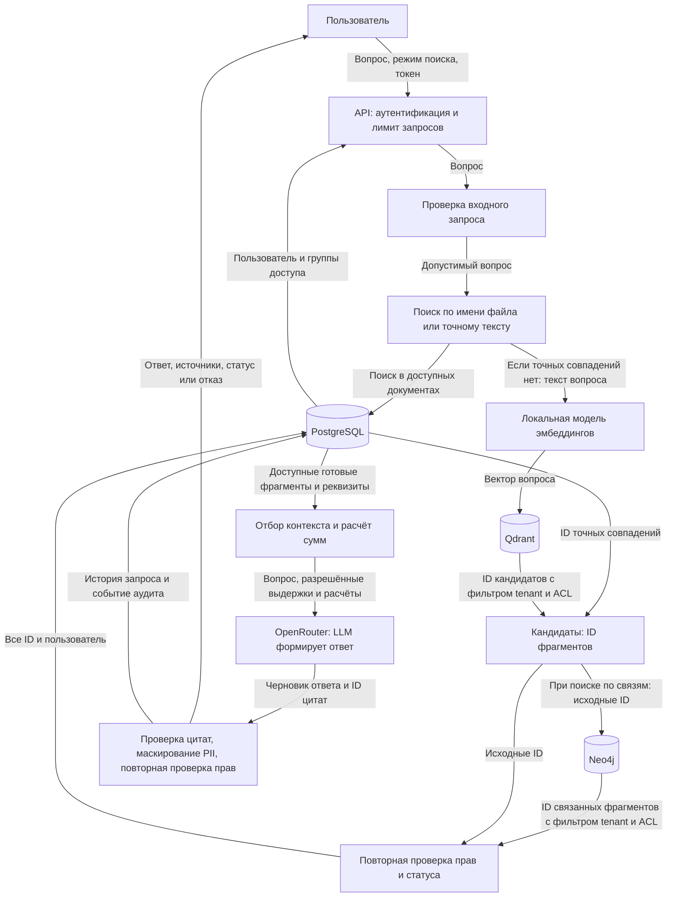
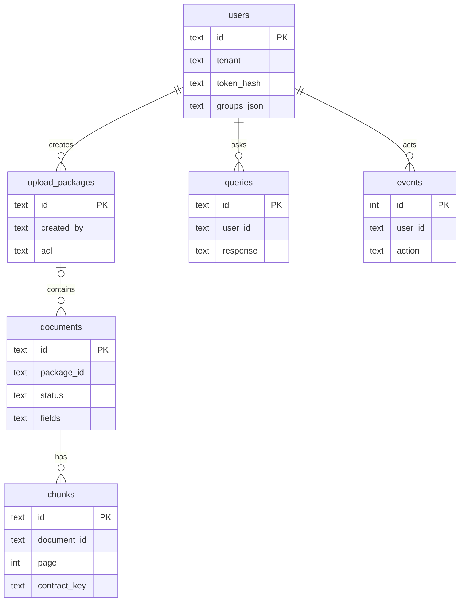

# Архитектура AccMind MVP

Работающий контур: браузер, один FastAPI-процесс, PostgreSQL, MinIO, Qdrant и Neo4j.
OCR, извлечение реквизитов и генерация используют OpenRouter. Эмбеддинги
вычисляются внутри API. Управление и обработка данных разделены логически
внутри одного процесса.

[ADR](../adr/README.md) объясняют выбор компонентов. [Целевая схема](target-architecture.md)
объединяет исходный микросервисный конвейер с функциями MVP.

## C4: контекст системы

## C4: контейнеры

## C4: компоненты API

## Deployment: доступ к MVP по IP

Для доступа по IP Compose публикует порт 8080 сервера. PostgreSQL, MinIO,
Qdrant и Neo4j доступны только внутри сети Compose. Jaeger запускается
отдельным профилем. Обработка файлов и вопросов выполняется в одном API-процессе.

## Sequence: загрузка и вопрос

Диаграммы показывают ранние отказы, обращения к хранилищам и повторные проверки
прав.

## Data Flow: загрузка и индексация

## Data Flow: поиск и ответ

Документ проходит `accepted → extracting → validating → indexing → ready`
либо `failed`. При ошибке индексации он не выдаётся как готовый. Общей транзакции
между PostgreSQL, Qdrant и Neo4j нет. После остановки API незавершённые документы
переводятся в `failed`. Пакет - одна операция загрузки, связь по договору строится
отдельно из подтверждённых реквизитов.

## ER: данные приложения

PostgreSQL хранит шесть таблиц. Связи на диаграмме логические: внешние ключи
в текущей DDL не объявлены.

`users` хранит tenant, хэш токена, группы и право загрузки. `upload_packages` -
партии. `documents` - имена, SHA-256, ACL, статусы и поля с цитатами.
`chunks` - текст, страницы и ключ договора. `queries` - историю. `events` - аудит.
Уникальность `(tenant, sha256)` предотвращает повторную загрузку. Старые документы
могут не иметь `package_id`. Дубликат остаётся в первоначальном пакете.

MinIO хранит оригиналы в `accmind-documents`. Qdrant содержит вектор и payload
фрагмента с tenant/ACL. Размерность текущей коллекции - 384. Neo4j хранит
`Document-[:HAS_CHUNK]->Chunk-[:REFERS_TO]->Contract`. Ключ договора включает
номер, дату и ИНН сторон. Совместимый вариант использует один ИНН. Ребро
создаётся только для фрагмента с подтверждающей цитатой номера.

## Доступ и границы безопасности

| Пользователь | Группы | Загрузка |
|---|---|---|
| `accountant` | `shared`, `finance` | Разрешена |
| `reader` | `shared` | Недоступна |

Токен определяет principal на сервере и хранится в `sessionStorage` вкладки.
Права назначаются по серверной записи пользователя. Актуальный ACL проверяется перед
передачей контекста модели, после генерации, при чтении истории и оригиналов.

| Риск | Мера MVP | Ограничение |
|---|---|---|
| Закрытый акт связан с открытым договором | Фильтры индексов и повторный ACL по PostgreSQL | Переданный модели текст нельзя отозвать |
| Injection в вопросе или документе | Regex известных шаблонов, разделение инструкций и данных | Покрыты известные шаблоны injection |
| Выдуманные источники и суммы | UUID цитат из контекста, расчёт через `Decimal` | Обоснованность утверждений требует отдельной оценки |
| Утечка PII | Маскирование некоторых форматов в ответе | OCR-текст уже передаётся провайдеру |
| Большой или неверный файл | Проверка содержимого, размера и страниц | Полноценного антивирусного контура нет |
| Утечка секретов | Файлы Compose secrets вне Git и образа | Администратор хоста/Docker имеет доступ |

Документы для демонстрации синтетические. Внешний IdP, распределённая очередь,
автоматическое восстановление индексов и backup/restore не реализованы.

## API и исходники

Маршруты `/api/v1` охватывают пользователей, пакеты, документы, обработку,
вопросы и историю. `/metrics` и readiness доступны только пользователю с правом
загрузки. Liveness не требует токена. Readiness проверяет хранилища и наличие
настроек модели, но не вызывает провайдера. Схема - [openapi.json](../api/openapi.json).

[main.py](../../mvp/app/main.py) связывает маршруты и зависимости,
[uploads.py](../../mvp/app/uploads.py) принимает файлы,
[ingestion.py](../../mvp/app/ingestion.py) обрабатывает страницы,
[workflow.py](../../mvp/app/workflow.py) выполняет граф вопроса.
[models.py](../../mvp/app/models.py), [indexes.py](../../mvp/app/indexes.py),
[repository.py](../../mvp/app/repository.py) и [storage.py](../../mvp/app/storage.py)
отвечают за модели, поиск, метаданные и оригиналы.
