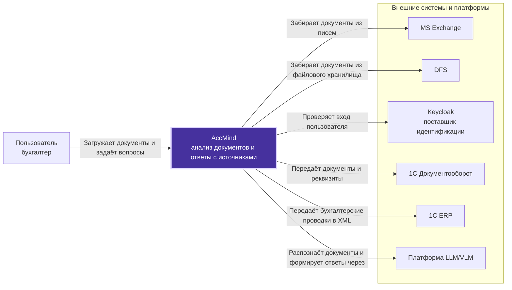
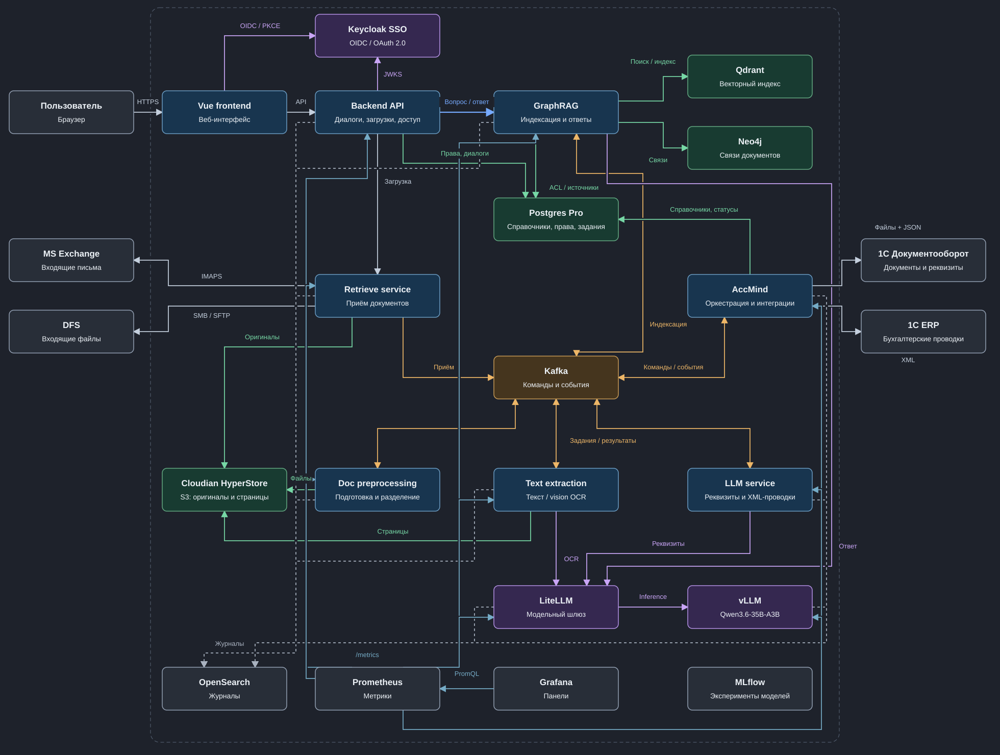
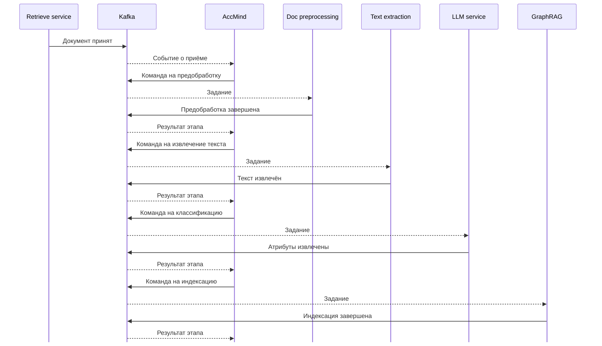
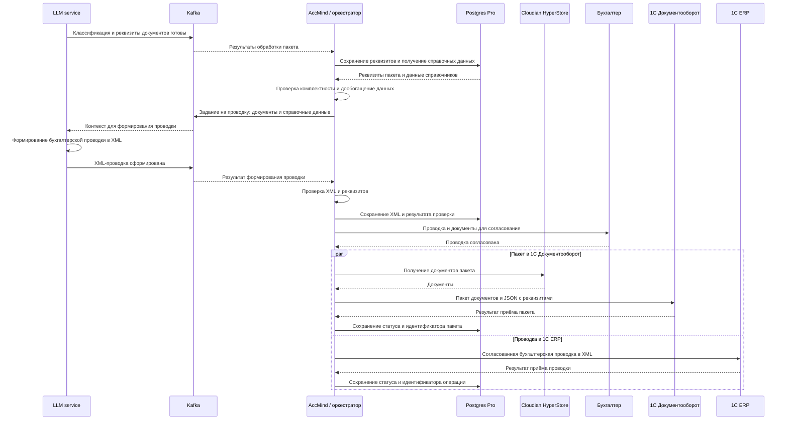

# Целевая архитектура AccMind

Целевое решение объединяет обработку бухгалтерских документов, чат с ответами
по их содержанию и интеграцию с 1С. Документы поступают из почты, файловых
хранилищ и через веб-интерфейс. Система распознаёт текст, определяет типы
документов, извлекает реквизиты и связывает договоры, акты и платежи.

Бухгалтер получает ответы с цитатами и ссылками на оригиналы, расчёты сумм
и бухгалтерские проводки в XML для передачи в 1С ERP. Доступ к документам и источникам
ответов определяется правами пользователя.

Обработка документов строится на событийной архитектуре (event-driven):
сервисы обмениваются командами и событиями через Kafka. Завершение одного
этапа запускает следующий. Оркестратор хранит состояние всего пакета.

## 1. C4 Level 1 - System Context (Контекст системы)

## 2. C4 Level 2 - Container (Контейнеры)

### Компоненты и ответственность

| Компонент | Назначение |
|---|---|
| Vue frontend | Загрузка пакетов, статусы обработки, чат и просмотр источников |
| Backend API | Пользовательские запросы, диалоги и проверка доступа |
| Keycloak | Корпоративный вход и идентификация пользователей |
| Retrieve service | Приём документов из MS Exchange, DFS и пользовательских загрузок |
| Doc preprocessing | Подготовка файлов и разделение документов на страницы |
| Text extraction | Извлечение текстового слоя и распознавание сканов |
| LLM service | Классификация, извлечение реквизитов и формирование XML-проводок |
| AccMind | Оркестрация обработки пакетов, проверка результатов и интеграции с 1С |
| Kafka | Передача команд обработки и событий о результатах этапов |
| GraphRAG | Индексация, поиск по содержанию и связям, формирование ответов с источниками |
| Cloudian HyperStore | Хранение оригиналов и подготовленных страниц |
| Postgres Pro | Справочники для формирования проводок, метаданные, права, диалоги и статусы пакетов |
| Qdrant | Векторный поиск по фрагментам документов |
| Neo4j | Связи между документами и расширение контекста поиска |
| LiteLLM и vLLM | Единый модельный API и локальное выполнение Qwen3.6-35B-A3B |

### Обработка документов и вопросов

Обработка пакета выполняется асинхронно. Оркестратор последовательно запускает
подготовку страниц, извлечение текста, классификацию и индексацию.
Сервисы получают задания через Kafka и публикуют результаты этапов.
Файлы хранятся в Cloudian, состояние обработки - в Postgres Pro.

Вопрос проходит через Backend API в GraphRAG. Поиск объединяет релевантные
фрагменты из Qdrant и связанные документы из Neo4j. Права доступа проверяются
до передачи контекста модели и при выдаче ответа. Ответ содержит цитаты
и ссылки на оригиналы. История вопросов и ответов сохраняется в Postgres Pro.

### Мониторинг

OpenSearch хранит журналы Backend API, сервисов обработки, оркестратора,
GraphRAG и модельного контура. Записи содержат имя сервиса, идентификаторы
пакета и задания, этап и результат обработки. Сбор журналов выполняется
средствами контейнерной платформы. Текст документов в журналы не записывается.

Prometheus опрашивает `/metrics` сервисов, Grafana отображает показатели
и оповещения об ошибках и задержках.

| Источник | Основные показатели |
|---|---|
| Backend API, GraphRAG | Время запросов, поиска и генерации, ошибки и запросы к документам без прав доступа |
| Retrieve, AccMind | Число принятых файлов, время ожидания обработки, статусы пакетов и повторные попытки |
| Doc preprocessing, Text extraction, LLM service | Время обработки, число страниц, ошибки распознавания и извлечения |
| LiteLLM, vLLM | Время ответа модели, число токенов, ошибки и очередь запросов |

MLflow хранит параметры и результаты экспериментов с моделями для сравнения
качества распознавания, извлечения реквизитов и ответов.

## 3. UML Sequence - Асинхронная обработка документа

## 4. UML Sequence - Формирование проводки и передача в 1С

Оркестратор собирает реквизиты документов пакета и получает из Postgres Pro
справочные данные для их дообогащения. LLM service использует документы
и справочники как контекст для формирования итоговой бухгалтерской проводки
в XML по формату обмена с 1С ERP.

Оркестратор проверяет структуру XML, комплектность данных и соответствие
реквизитов документам и справочникам. После согласования бухгалтером проводка
передаётся в 1С ERP. В 1С Документооборот отправляются документы пакета
и их реквизиты. Результаты приёма сохраняются в Postgres Pro.

## Обработка ошибок

Оркестратор сохраняет этап и результат обработки каждого пакета.
При временной недоступности сервиса задание выполняется повторно.
Идентификаторы пакетов и операций позволяют распознать повторное сообщение
и предотвратить повторную отправку одной проводки в 1С.
Если обработка завершается ошибкой, сохраняются причина и этап сбоя.
Пакет доступен для проверки и повторного запуска.
